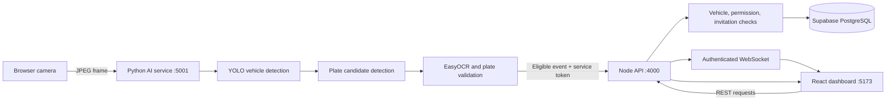

# License Plate Recognition Project Guide

This is the main user and developer guide for the Autonomous Vehicle Analytics / License Plate Recognition System (LPRS). It describes the current Python AI service, Node.js API, React dashboard, Supabase data model, setup, and end-to-end workflows.

> **Prototype notice:** This repository is a research and demonstration system, not a production gate controller. Validate camera accuracy, access rules, authentication, retention, and hardware behavior in a controlled environment before relying on it for real access decisions.

## Contents

- [Project at a glance](#project-at-a-glance)
- [Features](#features)
- [System architecture](#system-architecture)
- [End-to-end workflows](#end-to-end-workflows)
- [Access decision rules](#access-decision-rules)
- [Installation and configuration](#installation-and-configuration)
- [Run the connected dashboard](#run-the-connected-dashboard)
- [API and live links](#api-and-live-links)
- [Database and persistence](#database-and-persistence)
- [Dataset, models, and training](#dataset-models-and-training)
- [Tests and checks](#tests-and-checks)
- [Security, privacy, and limitations](#security-privacy-and-limitations)
- [Troubleshooting](#troubleshooting)
- [Repository links](#repository-links)
- [External references](#external-references)

## Project at a glance

LPRS detects vehicles and license plates, reads registration text, applies format and authorization checks, records events, and presents operational data in a browser dashboard.

| Component | Location | Responsibility |
|---|---|---|
| Python AI service | [`src/ai_service.py`](src/ai_service.py) | Accepts JPEG frames, runs vehicle/plate detection and OCR, validates the read, and forwards eligible events. |
| AI modules | [`src/`](src/) | Detection, OCR, plate normalization, runtime decisions, camera support, training and evaluation utilities. |
| Node.js backend | [`backend/src/server.js`](backend/src/server.js) | API, authentication, access decisions, persistence, audit logging, visit lifecycle, and WebSocket delivery. |
| React dashboard | [`frontend/src/main.jsx`](frontend/src/main.jsx) | Live monitoring, vehicle operations, customer workflows, reporting, and local/demo fallback. |
| Browser data/API adapter | [`frontend/src/services/localStorageService.js`](frontend/src/services/localStorageService.js) | Connects dashboard workflows to the backend and maintains browser-local fallback data. |
| Supabase schema | [`supabase/schema.sql`](supabase/schema.sql) | Base PostgreSQL tables, indexes, policies, and database functions. |
| Supabase migration | [`supabase/migrations/20260911_enhance_invitations_permissions.sql`](supabase/migrations/20260911_enhance_invitations_permissions.sql) | Adds time windows, audit/support fields, indexes, and later schema enhancements. |

## Features

### AI and license-plate processing

- YOLO-based vehicle detection and a plate-candidate detector.
- Plate cropping and OCR using EasyOCR; preprocessing and candidate crops help select a readable result.
- Plate text normalization to uppercase alphanumeric characters and format validation.
- Confidence and format signals are passed with events so uncertain reads can be reviewed rather than treated as proof of unauthorized access.
- Configurable model path, camera index, detector/OCR thresholds, and demo allow/deny plate sets through [`src/config.py`](src/config.py).
- Separate utilities for dataset preparation, XML-to-YOLO conversion, annotation review, training, OCR evaluation, and model smoke tests.

### Operations dashboard

The navigation in [`frontend/src/main.jsx`](frontend/src/main.jsx) includes:

| Area | What it supports |
|---|---|
| Dashboard | Current operational counters and recent detections. |
| Live Monitoring | Browser camera preview, capture controls, and latest AI result. |
| Vehicles | Searchable vehicle registry and record/status review. |
| Register Vehicle | Add vehicle and owner/customer details. |
| Permissions | Create and review time-bounded access permissions. |
| Invitations | Schedule visitor access for a plate and time window. |
| Visit History | Review entry, last-seen, and exit history. |
| Vehicle Verification Center | Manually check a plate against registration, invitations, visits, permissions, detections, and alerts. |
| Alerts | Review access/OCR alerts and acknowledge them. |
| Password Requests | Review customer password-reset requests. |
| Complaints | Submit customer support issues and manage their status/reply. |
| Analytics | Review aggregate detections and current-visit metrics. |
| Reports | Filter/export operational data; the dashboard includes CSV and print/PDF workflows. |
| Settings | Camera and AI connection diagnostics. |

The application also has role-specific customer workflows for linked vehicles, invitations, complaints, and account support. Sample/demo records and localStorage fallback are browser-local and are not a shared system of record.

### Backend and access operations

- Supabase Auth bearer-token authentication when Supabase is configured; admin/service routes are role-checked.
- Service-token authentication for the Python event producer.
- Vehicle/customer-scoped reads for customer accounts.
- Detection idempotency and short-window duplicate suppression.
- Detection, visit, vehicle-session, evidence, alert, and audit-log records.
- WebSocket snapshots and live detection broadcasts.
- Automatic closure of inactive visits/sessions and scheduled invitation/permission expiry and data retention sweeps.

## System architecture



If Supabase is not configured, the backend has an in-memory event fallback for local development. This is not equivalent to full Supabase-backed login, authorization, persistence, reporting, or customer workflows.

## End-to-end workflows

### Live camera detection

1. Start the dashboard and enable its browser camera. The browser requests camera permission and captures JPEG frames.
2. The dashboard posts each frame to `POST http://localhost:5001/process-frame`.
3. [`src/ai_service.py`](src/ai_service.py) decodes the frame, detects the strongest vehicle candidate, searches plate candidates, runs OCR, and produces a status/decision payload. It returns `NO_VEHICLE`, `NO_PLATE`, OCR statuses, or a detection result as appropriate.
4. Only a format-valid plate result that passes the service's forwarding condition is posted to `POST http://localhost:4000/api/events`. The AI service sends a bearer service token when configured.
5. The backend suppresses near-duplicate events, evaluates the plate against registered vehicles, permissions, and invitations, then writes the detection and associated visit/alert/session data when Supabase is configured.
6. The backend broadcasts a `vehicle_detected` WebSocket message. Connected dashboards update their live event views.

### Authorization lifecycle

1. An administrator registers a vehicle or creates a permission; an administrator or customer can create an invitation according to the account workflow.
2. On a valid plate read, the backend normalizes the plate and evaluates current database records and timestamps.
3. It records the decision, the reason/context available to the event, the visit, and any alert required for the status.
4. Repeat detections update the active visit/session. Inactive visits are closed using `VISIT_CLOSE_AFTER_MS` (default 120 seconds); the backend checks for inactivity every 30 seconds.
5. Invitation and permission expiry plus retention cleanup run on the configured retention interval (default six hours). The SQL cleanup function is intended to remove records older than 31 days.

### Standalone camera and hardware prototype

[`src/live_lprs.py`](src/live_lprs.py) is a separate OpenCV live-camera prototype. It can use an Arduino-compatible serial board for a buzzer; the documented commands are byte `1` to turn on and byte `0` to turn off. The interactive controls include `O` to switch off and `Q` to quit. Camera, serial hardware, firmware, and physical buzzer timing must be tested on the target equipment. This path is distinct from the browser-camera/API workflow.

## Access decision rules

The backend decision implementation is in [`backend/src/server.js`](backend/src/server.js). Its central rules are:

| Condition | Result |
|---|---|
| No readable plate, uncertain OCR, or invalid format | `UNKNOWN`; OCR failure is not proof of unauthorized access. |
| Vehicle record is blocked | `UNAUTHORIZED`. |
| Registered vehicle has a usable permission or valid legacy vehicle window | `AUTHORIZED`. |
| Permission window has expired | `UNAUTHORIZED` with an expiry status. |
| Invitation is blocked/cancelled or outside its active window | `UNAUTHORIZED`. |
| Invitation is active at the detection timestamp | `AUTHORIZED`. |
| No matching vehicle or active invitation | `UNREGISTERED` / `UNAUTHORIZED`. |

The plate validator currently supports selected Indian registration formats, not every state, RTO, or special registration pattern. See [`src/plate_validator.py`](src/plate_validator.py). Treat borderline reads as a manual review case.

## Installation and configuration

Use Python, Node.js, npm, and a Supabase project for the complete persistent/authenticated workflow.

### Python

From the project directory:

```powershell
python -m venv .venv
.venv\Scripts\activate
python -m pip install -r requirements.txt
```

The dependency list is in [`requirements.txt`](requirements.txt). It includes OpenCV, Ultralytics, EasyOCR, NumPy, Pandas, Pillow, pyserial, OpenAI-compatible client support, and python-dotenv.

### Supabase database

1. Create a Supabase project.
2. In its SQL Editor, run [`supabase/schema.sql`](supabase/schema.sql).
3. Then run [`supabase/migrations/20260911_enhance_invitations_permissions.sql`](supabase/migrations/20260911_enhance_invitations_permissions.sql).
4. Create/configure Auth users with `ADMIN` or `CUSTOMER` role metadata as appropriate.
5. Configure the backend using [`backend/.env.example`](backend/.env.example). The service-role key belongs on the backend only.

Detailed Supabase notes are in [`SUPABASE_SETUP.md`](SUPABASE_SETUP.md). Database SQL must be applied to the Supabase project; merely having the SQL file in the repository does not deploy it.

### Environment files

Copy examples to local `.env` files and fill in secrets locally. `.env` files are ignored by Git.

| File | Important settings |
|---|---|
| [`.env.example`](.env.example) | `LPRS_AI_PORT`, `LPRS_BACKEND_URL`, `LPRS_MODEL_PATH`, camera/threshold/plate settings, and the OpenAI-compatible `OMNIROUTE_BASE_URL` / `OMNIROUTE_API_KEY` used by the AI module's review client. |
| [`backend/.env.example`](backend/.env.example) | `PORT`, `SUPABASE_URL`, backend-only `SUPABASE_SERVICE_ROLE_KEY`, and `SERVICE_TOKEN`. |
| `frontend/.env` (create locally) | `VITE_API_URL=http://localhost:4000` and `VITE_AI_URL=http://localhost:5001`. |

Never put a service-role key, service token, or provider API key in frontend environment variables or commit them. The Python service reads its project-root `.env`; the Node backend reads its backend `.env` when started from the backend directory.

### Useful Python settings

| Variable | Default | Use |
|---|---|---|
| `LPRS_AI_PORT` | `5001` | Python HTTP service port. |
| `LPRS_BACKEND_URL` | `http://localhost:4000/api/events` | Event destination. |
| `LPRS_MODEL_PATH` | Configured trained weights path | Override the plate model. |
| `LPRS_CAMERA_INDEX` | `0` | OpenCV camera index for standalone mode. |
| `LPRS_YOLO_CONFIDENCE` | `0.25` | Detection confidence threshold. |
| `LPRS_OCR_CONFIDENCE` | `0.30` | OCR confidence threshold. |
| `LPRS_SERIAL_PORT` | `COM6` | Standalone Arduino serial port. |
| `LPRS_BAUD_RATE` | `9600` | Serial speed. |
| `LPRS_BUZZER_SECONDS` | `5` | Standalone buzzer duration. |
| `LPRS_AUTHORIZED_PLATES` | Demo plate list | Comma-separated development allowlist. |
| `LPRS_UNAUTHORIZED_PLATES` | Demo plate list | Comma-separated development denylist. |

## Run the connected dashboard

Start each service in a separate PowerShell terminal from the project directory:

```powershell
python src\ai_service.py
```

```powershell
cd backend
npm install
npm start
```

```powershell
cd frontend
npm install
npm run dev
```

Open the Vite URL printed by the frontend, normally `http://localhost:5173`, sign in using a configured account, and enable the camera. Browser camera access generally requires localhost or HTTPS. For standalone OpenCV/Arduino mode, see [`src/live_lprs.py`](src/live_lprs.py) and its configuration in [`src/config.py`](src/config.py).

## API and live links

### Local service links

| Service | URL | Purpose |
|---|---|---|
| Dashboard | `http://localhost:5173` | Vite development UI. |
| Backend health | `http://localhost:4000/health` | API and database mode. |
| Backend system status | `http://localhost:4000/api/system/status` | API/database/AI/mode status. |
| Python AI health | `http://localhost:5001/health` | Python pipeline health. |
| Python frame endpoint | `http://localhost:5001/process-frame` | `POST` a JSON body containing a base64 JPEG `image`. |
| Backend WebSocket | `ws://localhost:4000/ws` | Snapshot and live detection messages; configured deployments require a token query parameter. |

### Backend endpoint catalog

When Supabase is configured, send `Authorization: Bearer <access-token>` to protected API endpoints. The Python producer uses the configured service token. `/health`, `/api/system/status`, and authentication/password-reset request endpoints are the public exceptions described by the current middleware.

| Method | Endpoint | Purpose / access |
|---|---|---|
| `GET` | `/health` | Backend and database health. |
| `GET` | `/api/system/status` | API/database/mode status. |
| `POST` | `/api/auth/login` | Sign in with username/password. |
| `POST` | `/api/auth/refresh` | Refresh a Supabase session. |
| `POST` | `/api/auth/admin-password-reset` | Request admin reset email without disclosing account match. |
| `GET` | `/api/customers`, `/api/customers/:id` | Customer records; list is admin-only, detail is owner/admin scoped. |
| `GET` | `/api/vehicles`, `/api/vehicles/:plate` | List/search and look up vehicles; customer reads are scoped. |
| `POST` / `PATCH` | `/api/vehicles`, `/api/vehicles/:id` | Create/update vehicle; admin-only. |
| `GET` | `/api/vehicle-sessions` | Read active/recent sessions, scoped to the account. |
| `GET` / `POST` | `/api/invitations` | List/create invitation windows. |
| `PATCH` | `/api/invitations/:id/status` | Change invitation status; admin-only. |
| `GET` / `POST` | `/api/permissions` | List/create permissions; creation is admin-only. |
| `PATCH` | `/api/permissions/:id/status` | Change permission status; admin-only. |
| `GET` / `POST` | `/api/events` | Read detections / submit a detection; writes require admin or service role. |
| `GET` | `/api/visits` | Read visit history, scoped to the account. |
| `GET` / `POST` | `/api/alerts`, `/api/alerts/:id/read` | List alerts and acknowledge one. |
| `GET` | `/api/analytics/dashboard` | Dashboard counts; admin-only. |
| `GET` / `POST` | `/api/evidence` | List/register evidence metadata. |
| `GET` | `/api/evidence/:name` | Serve a local evidence file by basename. |
| `POST` | `/api/password-reset/request` | Submit a customer reset request. |
| `GET` / `POST` | `/api/password-reset/requests`, `/api/password-reset/:id/resolve` | Admin review and resolution. |
| `GET` / `POST` | `/api/complaints` | List/submit support complaints. |
| `PATCH` | `/api/complaints/:id` | Admin status/reply update. |

See the route implementation and validation details in [`backend/src/server.js`](backend/src/server.js). The precise response shape may evolve with the API.

## Database and persistence

The base schema defines these main entities: organizations, profiles, customers, vehicles, invitations, permissions, detections, visits, vehicle sessions, evidence, alerts, password-reset requests, complaints, and audit logs. The migration adds richer time-window and support/audit fields. Row Level Security is enabled on the application tables; API access also applies role and ownership checks.

When Supabase is configured, it is the persistent system of record. Without it, the backend's in-memory fallback is useful only for limited local event demonstrations; many list endpoints return empty data and login/persistent access-management workflows are unavailable. Browser localStorage is a separate offline/demo fallback and does not sync across browsers by itself.

Retention behavior is implemented in the backend and SQL cleanup function: configured records older than 31 days are intended to be deleted. Review the SQL function and retention requirements before using real personal data.

## Dataset, models, and training

- `data/dataset/State-wise_OLX/` contains source images/annotations.
- [`data/yolo_dataset/data.yaml`](data/yolo_dataset/data.yaml) defines the YOLO splits and `license_plate` class.
- `data/yolo_dataset/images/` and `data/yolo_dataset/labels/` hold train/validation/test data.
- `yolo11n.pt` is a base YOLO model artifact; trained artifacts are selected via `LPRS_MODEL_PATH`.
- [`src/prepare_yolo_dataset.py`](src/prepare_yolo_dataset.py), [`src/convert_xml_to_yolo.py`](src/convert_xml_to_yolo.py), [`src/train_plate_model.py`](src/train_plate_model.py), and the evaluation/review scripts cover data preparation and model experimentation.

The dataset includes images with vehicle registrations. Confirm licensing and consent before redistributing or using the images outside this project. `data/yolo_dataset/data.yaml` uses relative split paths, but verify the dataset root from the directory where training is launched.

## Tests and checks

Useful repository checks include:

```powershell
python -m compileall -q src
python src\test_lprs_runtime.py -q
python src\test_validator.py
python src\test_vehicle_database.py
npm run build --prefix frontend
```

Additional smoke scripts are listed under [`src/`](src/). Hardware-dependent tests require a camera/serial device; OCR/detection quality requires representative labeled images. Passing unit/build checks does not validate end-to-end accuracy, Supabase deployment, or physical access-control behavior.

## Security, privacy, and limitations

- Keep Supabase service-role keys and service tokens in backend-only local environment files. Never publish actual credentials.
- The repository's dataset contains visible license plates; treat those images as potentially identifying information.
- Use HTTPS and trusted origins for deployment. The Python frame service currently permits cross-origin requests and should not be exposed directly to an untrusted network without additional controls.
- Do not treat an OCR miss as an unauthorized decision. Use an operator review path for uncertain reads.
- Current plate-format validation covers only selected Indian formats; false reads and unsupported registrations are possible.
- This codebase does not provide a complete production threat model, calibrated recognition accuracy, robust multi-camera tracking, guaranteed evidence capture, or verified Arduino firmware/wiring.
- LocalStorage and in-memory event storage are not durable, shared production storage.
- Validate authentication, ownership, database policies, data retention, and backups in the deployed Supabase project.

## Troubleshooting

| Symptom | Checks |
|---|---|
| Dashboard says backend is offline | Start the Node backend; open `http://localhost:4000/health`; verify `VITE_API_URL`. |
| AI health is unavailable | Start `python src\\ai_service.py`; open `http://localhost:5001/health`; check Python dependencies and `.env`. |
| Camera will not start | Grant browser permission, use localhost/HTTPS, select an available camera, and check whether another app is using it. |
| Backend reports `IN_MEMORY` | Configure `SUPABASE_URL` and `SUPABASE_SERVICE_ROLE_KEY` in `backend/.env`, then restart the backend. |
| Permission sync reports missing table/columns | Apply the base schema, then the enhancement migration in the Supabase SQL Editor. |
| Python cannot load weights | Check `LPRS_MODEL_PATH` and confirm the model file exists at that path. |
| Event is not persisted | Check plate format/status, backend health, service token alignment, Supabase connectivity, and backend logs. |
| Arduino cannot connect | Confirm `LPRS_SERIAL_PORT`, baud rate, board firmware, and physical wiring; the browser AI path does not require Arduino. |

## Repository links

- [Quick-start README](README.md)
- [Legacy detailed project notes](PROJECT_README.md)
- [Implementation status/plan](PLAN.md)
- [Supabase setup notes](SUPABASE_SETUP.md)
- [Python source and checks](src/)
- [Backend source](backend/src/)
- [Frontend source](frontend/src/)
- [Dataset and YOLO configuration](data/)
- [Supabase schema and migrations](supabase/)

## External references

- [Supabase documentation](https://supabase.com/docs)
- [Supabase JavaScript client](https://supabase.com/docs/reference/javascript/introduction)
- [Vite guide](https://vite.dev/guide/)
- [React documentation](https://react.dev/)
- [Ultralytics documentation](https://docs.ultralytics.com/)
- [OpenCV documentation](https://docs.opencv.org/)
- [EasyOCR repository](https://github.com/JaidedAI/EasyOCR)